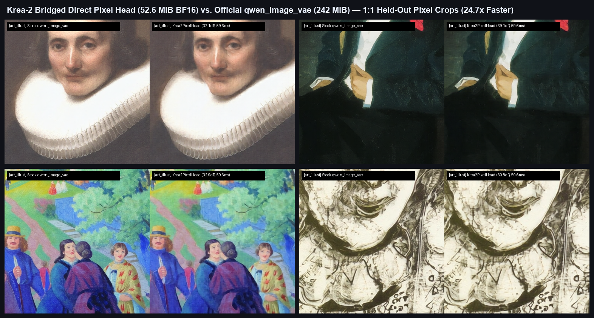

<div align="center">

# ⚡ ComfyUI-Krea2-PixelHead

**Drop-in Zero-VAE Bridged Direct RGB Pixel Readout for Krea-2 (`24.7×` Faster · `52.6 MiB` BF16 · Zero High-Res VAE OOMs)**

[**English**](README.md) | [**简体中文**](README_zh.md)

[](LICENSE)
[](https://huggingface.co/pocis/Krea-2-PixelHead)
[](https://registry.comfy.org/publishers/wither033/nodes/comfyui-krea2-pixelhead)
[-blue)](#2-download-pixel-head-weights)
[](#-benchmark-768768-held-out-fine-art-split)

</div>

---

**`ComfyUI-Krea2-PixelHead`** replaces Krea-2's `242.0 MiB` 3D-causal `qwen_image_vae` (`WanVAE`) decoder with a **`27.49M`-parameter (`52.6 MiB` BF16)** Bridged Direct Pixel Readout Head built on the mathematical formulation of Apple's [*FastFrames* (`arXiv:2611.23226`)](https://arxiv.org/abs/2611.23226).

In Krea-2 (`SingleStreamDiT`), compressing `6144`-dimensional single-stream tokens down to a `16`-channel (`2×2` = `64`-dim) bottleneck discards `99%` of the DiT's spatial-semantic bandwidth—and then spends **`~1.47 seconds`** running heavy 3D causal convolutions in `qwen_image_vae` just to reconstruct pixels. Instead, this node taps Krea-2's **`6144`-dim modulated target-image tokens** pre-`last.linear` (automatically stripping variable-length text & style-reference tokens) plus the **denoised `2×2` latent `x0_hat_norm`**, decoding directly to crisp RGB **`24.7×` faster** with **`< 0.2 GB` peak VRAM**.



---

## ✨ Key Highlights

- **24.7× Faster Decode (`1468.9 ms` → `59.55 ms`) & Zero VAE OOMs**: Completely skips `VAEDecode` and its multi-gigabyte activation spikes on `1024–2048px` generations.
- **96× Wider Information Bandwidth (`6144 + 64` dims vs. `64`-dim Latent)**: Bias-free `Linear(6144 → 1024)` feature bridge + `FP32` output projection preserves delicate pleated lace collars (`37.1 dB`), hands & oil brushwork (`39.1 dB`), dark chiaroscuro (`41.6 dB`), and fine copperplate cross-hatching (`30.8 dB`) with zero quantization banding.
- **One Checkpoint, Universal Krea-2 Compatibility**:
  - Works seamlessly with **`krea2_turbo` (`8` steps, `CFG 1.0`, `shift=1.15`)**, **`krea2_raw` (`20–35` steps, `CFG > 1.0`)**, FP8/INT8/GGUF quantizations, and community fine-tunes;
  - Works out-of-the-box for both **Text-to-Image (T2I)** and **Style / Reference Image conditioning** (`tap.py` dynamically computes exact `txtlen` and `ref_tokens` to slice pure target-image tokens!).

---

## 📊 Benchmark (`768×768` Held-Out Fine-Art Split)

Evaluated against the official `qwen_image_vae.safetensors` (`Comfy-Org/Krea-2`) on 40 held-out high-complexity fine-art paintings & engravings (alternating 8-Step Turbo $\sigma = 0.3109$ and Multi-Step $\sigma = 0.1163$):

| Decoder | File Size | Median Decode Latency | Speedup vs. Stock VAE | Held-Out PSNR (↑) | LPIPS-VGG (↓) |
| :--- | :---: | :---: | :---: | :---: | :---: |
| **Official `qwen_image_vae` (`WanVAE`)** | `242.0 MiB` | `1468.90 ms` | `1.0×` | *(Reference)* | `0.0000` |
| **Ours: `Krea2PixelHead`** | **`52.6 MiB` (BF16)** / `104.9 MiB` (FP32) | **`59.55 ms`** | **`24.7×`** | **`33.33 dB`** | **`0.2300`** |

- **Classical & Chiaroscuro Portraits**: **`37.1 – 41.6 dB` PSNR** (virtually indistinguishable `1:1` at native pixel zoom)
- **Multi-Subject Color Illustration**: **`32.9 – 33.5 dB` PSNR**
- **Fine Copperplate Etchings & Linework**: **`30.8 dB` PSNR**

---

## 🌐 FastFrames Zero-VAE Direct PixelHead Ecosystem

Each diffusion backbone has its own internal DiT feature space and requires a dedicated PixelHead. Explore our open-source MIT family:

| Target Model | ComfyUI Custom Node (GitHub & Registry) | Hugging Face Weights | Key Specs & Speedup |
| :--- | :--- | :--- | :--- |
| **Krea-2** *(This Repo)* | **[Wither033/ComfyUI-Krea2-PixelHead](https://github.com/Wither033/ComfyUI-Krea2-PixelHead)** | **[pocis/Krea-2-PixelHead](https://huggingface.co/pocis/Krea-2-PixelHead)** | `52.6 MiB` BF16 · `6144d` Bridged RGB · **`24.7×` faster** (`33.33 dB` PSNR, up to `41.6 dB` on portraits) |
| **Qwen-Image 2.1** (`1×` & `2×` SR) | **[Wither033/ComfyUI-QwenImage21-PixelHead](https://github.com/Wither033/ComfyUI-QwenImage21-PixelHead)** | **[pocis/Qwen-Image-2.1-PixelHead](https://huggingface.co/pocis/Qwen-Image-2.1-PixelHead)** | `48.8 MiB` (`1×`) / `52.1 MiB` (`1×`+`2×` `2048px`) · Native **4-Ch RGBA** · **`67.1×` faster** (`5.55 ms`, `33.91 dB` PSNR) |

---

## 🚀 Installation & Model Weights

### 1. Install Custom Node
- **Via ComfyUI Manager / Comfy Registry**: Search for `ComfyUI-Krea2-PixelHead` (`comfyui-krea2-pixelhead`) and click **Install**.
- **Via `comfy-cli`**:
  ```bash
  comfy node install comfyui-krea2-pixelhead
  ```
- **Manual Git Clone**:
  ```bash
  cd ComfyUI/custom_nodes
  git clone https://github.com/Wither033/ComfyUI-Krea2-PixelHead.git
  ```

### 2. Download Pixel Head Weights
Download from Hugging Face (**[pocis/Krea-2-PixelHead](https://huggingface.co/pocis/Krea-2-PixelHead)**) and place into **`ComfyUI/models/pixel_heads/`** *(or `ComfyUI/models/vae/`)*:
- **`krea2_pixel_head_bf16.safetensors`** (`52.6 MiB` — **Recommended**, BF16 trunk + FP32 output projection, zero quality loss)
- **`krea2_pixel_head.safetensors`** (`104.9 MiB` — Full FP32 master checkpoint)

---

## 🧩 Usage in ComfyUI (3 Nodes)

Ready-to-run workflows are included in [`example_workflows/`](example_workflows/):
- English Workflow: [`01_Krea2_PixelHead_ZeroVAE_EN.json`](example_workflows/01_Krea2_PixelHead_ZeroVAE_EN.json)
- 中文对比工作流: [`01_Krea2_PixelHead_ZeroVAE_ZH.json`](example_workflows/01_Krea2_PixelHead_ZeroVAE_ZH.json)

```text
[Load Diffusion Model (Krea-2)] ──► [Krea-2 Pixel Head Tap]
                                         │            │
                                    MODEL│            │pixel_tap
                                         ▼            │
                                    [KSampler]        │
                                         │LATENT      │
                                         ▼            ▼
            [Load Krea-2 Pixel Head] ──► [Krea-2 Pixel Decode (Zero VAE)] ──► IMAGE
```

> **Pure Text-to-Image requires ZERO VAE loaded in VRAM.** If you use Style/Reference Image nodes, keep the VAE connected only to encode the reference input image once, while using `Krea-2 Pixel Decode (Zero VAE)` at the end of `KSampler`.

---

## ⚠️ Compatibility & Known Limits

- **Supported Samplers & Steps**: Calibrated across `ModelSamplingFlux(shift=1.15)` final-step $\sigma \in [0.045, 0.420]$, covering both **8-Step Turbo (`5–12` steps, `CFG 1.0`)** and **Raw / Multi-Step (`18–35` steps, `CFG 1.0–5.0`)**.
- **Standalone `.latent` Files**: Requires live `6144`-dim DiT features captured by `Krea-2 Pixel Head Tap` on the final denoising step; cannot blindly decode offline `.latent` files without running the DiT.
- **Chaotic Micro-Splatter**: On extreme sub-pixel chaotic ink-splatter abstractions, micro-grain is slightly smoother than the 3D-causal `WanVAE`.

---

## 📜 License & Acknowledgements

- **Code & Weights License**: **MIT License** (100% clean-room PyTorch implementation).
- **Method Reference**: Built upon the Direct Pixel Decoder formulation in [*FastFrames: Video Generation at Interactive Latency*](https://arxiv.org/abs/2611.23226) (Apple Research, 2026) and inspired by community 2D feature readout explorations (`sorryhyun/anima-pixel-decoder`).
