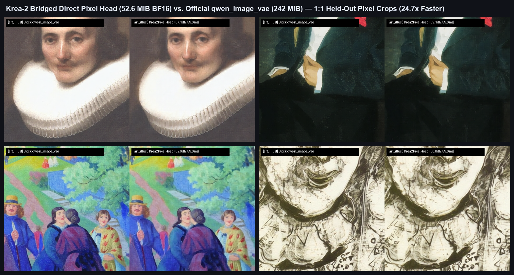

<div align="center">

# ⚡ ComfyUI-Krea2-PixelHead

**Krea-2 免 VAE 极速像素直出头（提速 `24.7×` · 仅 `52.6 MiB` BF16 · 彻底告别高分辨率解码爆显存）**

[**English**](README.md) | [**简体中文**](README_zh.md)

[](LICENSE)
[](https://huggingface.co/pocis/Krea-2-PixelHead)
[](https://registry.comfy.org/publishers/wither033/nodes/comfyui-krea2-pixelhead)
[-blue)](#2-%E4%B8%8B%E8%BD%BD%E5%83%8F%E7%B4%A0%E5%A4%B4%E6%9D%83%E9%87%8D)
[](#-%E5%AE%9E%E6%B5%8B%E6%80%A7%E8%83%BD%E5%9F%BA%E5%87%86768768-%E9%AB%98%E9%9A%BE%E8%89%BA%E6%9C%AF%E7%94%BB%E4%BD%9C%E7%95%99%E5%87%BA%E9%9B%86)

</div>

---

**`ComfyUI-Krea2-PixelHead`** 基于 Apple 2026 年 11 月最新论文 [*FastFrames* (`arXiv:2611.23226`)](https://arxiv.org/abs/2611.23226) 的直接像素读出（Direct Pixel Readout）架构，用仅 **`27.49M` 参数（`52.6 MiB` BF16）** 的轻量降维桥接 ConvNeXt + PixelShuffle 像素头，直接替代 `Krea-2` 耗时 **`~1.47 秒`**、高分辨率极易爆显存的 `242.0 MiB` 3D 因果 `qwen_image_vae` 解码器。

在 `Krea-2`（`SingleStreamDiT`）中，单流 Transformer 内部拥有高达 **`6144` 维**的丰富语义空间特征，传统流程却先将其强行压扁到 `16` 通道（`2×2 = 64` 维）潜空间，再用重型 3D 因果卷积 VAE 慢速放大。本插件在采样最后一步无侵入截获 `last.linear` 前的 **`6144` 维目标图像特征**（自动剥离变长文本与风格参考 token）与 **去噪潜块 `x0_hat_norm`**，解码速度提升 **`24.7 倍`**，额外峰值显存不到 **`0.2 GB`**！



---

## ✨ 核心优势

- **解码提速 `24.7×`（`1468.9 ms` → `59.55 ms`），彻底告别解码 OOM**：文生图全程无需加载任何 VAE，消除 `1024～2048px` 出图最后一步爆显存痛点。
- **信息带宽比潜空间小解码器高出 96 倍（`6144 + 64` 维输入）**：无偏置 `Linear(6144 → 1024)` 降维桥 + 末层强制 `FP32` 投影，完美保留文艺复兴百褶蕾丝衣领（`37.1 dB`）、油画手部笔触（`39.1 dB`）、暗调高反差肖像（`41.6 dB`）与细密铜版画排线（`30.8 dB`），零平涂色阶断层。
- **单权重全生态兼容**：
  - 同时支持 **`krea2_turbo`（8步 `CFG 1.0`）**、**`krea2_raw`（20～35步 `CFG > 1.0`）**、FP8/INT8/GGUF 量化版及各类社区微调底模；
  - 同时支持 **文生图（T2I）** 与 **风格参考图编辑（Style Reference）**（`tap.py` 动态精确剥离文本与参考图 token）。

---

## 📊 实测性能基准（`768×768` 高难艺术画作留出集）

以官方原版 `qwen_image_vae.safetensors`（`Comfy-Org/Krea-2`）为基准，在 40 张独立留出的高复杂度油画与铜版画样本上同种子对比（交替测试 8步 Turbo 与多步采样）：

| 解码器方案 | 权重体积 | 中位数解码延迟 | 相比官方 VAE 提速比 | 独立测试集 PSNR (↑) | LPIPS-VGG (↓) |
| :--- | :---: | :---: | :---: | :---: | :---: |
| **官方原版 `qwen_image_vae`** | `242.0 MiB` | `1468.90 ms` | `1.0×` | *(基准 Reference)* | `0.0000` |
| **Ours: `Krea2PixelHead`** | **`52.6 MiB` (BF16)** / `104.9 MiB` (FP32) | **`59.55 ms`** | **`24.7×`** | **`33.33 dB`** | **`0.2300`** |

---

## 🌐 FastFrames 免 VAE 极速像素头开源矩阵（同系列联动）

由于不同扩散底座的末层隐藏态特征空间彼此独立，我们为各主流开源底座逐一训练并开源了 MIT 协议专属像素头：

| 适配底座模型 | ComfyUI 插件仓（GitHub & 官方注册表） | Hugging Face 权重仓 | 核心规格与实测提速 |
| :--- | :--- | :--- | :--- |
| **Krea-2** *(当前仓库)* | **[Wither033/ComfyUI-Krea2-PixelHead](https://github.com/Wither033/ComfyUI-Krea2-PixelHead)** | **[pocis/Krea-2-PixelHead](https://huggingface.co/pocis/Krea-2-PixelHead)** | `52.6 MiB` BF16 · `6144d` 降维桥直出 RGB · **提速 `24.7×`**（高难艺术集均值 `33.33 dB`，肖像达 `37.1~41.6 dB`） |
| **Qwen-Image 2.1**（`1×` 与 `2×` 超分） | **[Wither033/ComfyUI-QwenImage21-PixelHead](https://github.com/Wither033/ComfyUI-QwenImage21-PixelHead)** | **[pocis/Qwen-Image-2.1-PixelHead](https://huggingface.co/pocis/Qwen-Image-2.1-PixelHead)** | `48.8 MiB` (`1×`) / `52.1 MiB` (`1×`+`2×` 直出 `2048`) · **原生 4 通道 RGBA** · **提速 `67.1×`**（`5.55 ms`，均值 `33.91 dB`） |

---

## 🚀 安装与权重下载

### 1. 安装 ComfyUI 插件
- **方式一（ComfyUI Manager / 官方注册表）**：打开插件管理器搜索 `ComfyUI-Krea2-PixelHead` 一键安装，或执行 `comfy node install comfyui-krea2-pixelhead`。
- **方式二（手动克隆）**：
  ```bash
  cd ComfyUI/custom_nodes
  git clone https://github.com/Wither033/ComfyUI-Krea2-PixelHead.git
  ```

### 2. 下载像素头权重
前往 Hugging Face（**[pocis/Krea-2-PixelHead](https://huggingface.co/pocis/Krea-2-PixelHead)**）下载权重，放入 **`ComfyUI/models/pixel_heads/`**（或 `ComfyUI/models/vae/`）：
- **`krea2_pixel_head_bf16.safetensors`**（`52.6 MiB` —— **主力推荐**，BF16 主干 + FP32 输出头，体积减半、零画质损失）
- **`krea2_pixel_head.safetensors`**（`104.9 MiB` —— 完整 FP32 母版权重）

---

## 🧩 ComfyUI 节点接法（附双语对比工作流）

[`example_workflows/`](example_workflows/) 目录内已附带中英双语工作流，直接拖入 ComfyUI 即可运行：
- 中文版：[`01_Krea2_PixelHead_ZeroVAE_ZH.json`](example_workflows/01_Krea2_PixelHead_ZeroVAE_ZH.json)
- 英文版：[`01_Krea2_PixelHead_ZeroVAE_EN.json`](example_workflows/01_Krea2_PixelHead_ZeroVAE_EN.json)

1. 将 **`Krea-2 Pixel Head Tap`** 串联在进入 `KSampler` 前的 `MODEL` 连线上；
2. 用 **`Krea-2 Pixel Decode (Zero VAE)`** 替代 `VAEDecode`，连接 `KSampler` 的 `LATENT`、`Load Krea-2 Pixel Head` 与 `pixel_tap` 即可。

---

## 📜 开源协议与致谢

- **开源协议**：**MIT License**（100% Clean-Room 独立实现，允许自由商用与云端平台集成）。
- **方法致谢**：源自 Apple Research [*FastFrames* (`arXiv:2611.23226`)](https://arxiv.org/abs/2611.23226) 直接像素解码器数学架构，并致谢社区 `sorryhyun/anima-pixel-decoder` 在 2D 扩散特征直出上的探索。
